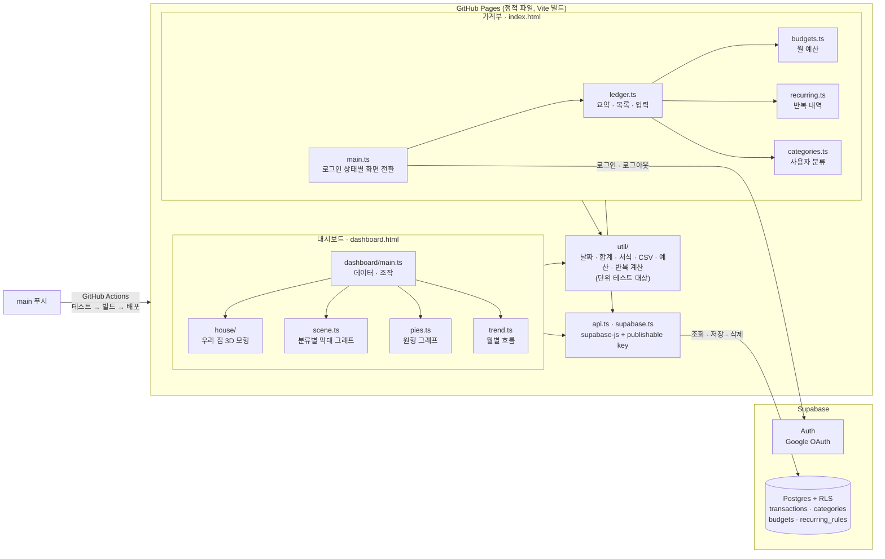

# hsh_budgetbook

수입과 지출을 기록하는 가계부 웹 애플리케이션입니다.

- 프런트엔드: Vite + TypeScript (프레임워크 없이 DOM 직접 조작)
- 배포: GitHub Pages (`https://neosdc.github.io/hsh_budgetbook/`)
- 데이터베이스와 로그인: Supabase (Postgres + Row Level Security, Google OAuth)

## 기능

- 수입/지출 등록, 수정, 삭제 (구분, 금액, 날짜, 분류, 메모, 위치·사람)
- 월 이동, 월별 잔액·수입·지출 요약(기본 접힘, 펼침 여부는 이 기기에 저장하고 3D 대시보드와 함께 씀)
- 날짜별 내역 목록과 구분 필터
- 지출 분류별 합계와 비중
- 검색: 메모·분류·위치·사람에서 부분 일치, 숫자만 입력하면 같은 금액도 찾음 (전체 기간, 최근 200건)
- CSV 내보내기: 지금 보이는 목록(월 또는 검색 결과, 구분 필터 적용) 또는 전체 기간. 엑셀에서 한글이 깨지지 않도록 UTF-8 BOM을 붙이고, 수식으로 해석될 수 있는 문자열(`=`, `+`, `-`, `@`로 시작)에는 앞에 `'`를 붙임
- 사용자 정의 분류: 지출/수입 분류 추가, 이름 변경(기존 내역의 분류 이름도 함께 변경), 순서 변경, 삭제(기록된 내역은 유지). 구분마다 하나 이상은 남겨야 함
- 월 예산과 초과 알림: 전체 지출 예산과 지출 분류별 예산을 설정하면(매달 같은 금액 적용) 월 화면에 사용률 막대가 표시됩니다. 예산의 80%에 이르면 경고, 넘으면 초과로 표시하고, 지출을 저장해 상태가 나빠지면 그 자리에서 알림 메시지를 띄웁니다. 푸시나 이메일 알림은 없으며 앱 안에서만 알립니다. 지출 분류 이름을 바꾸면 그 분류의 예산도 따라서 바뀝니다. 분류를 삭제해도 예산은 남고 예산 설정 창에서 "삭제된 분류"로 지울 수 있습니다.
- 반복 내역: 월세·구독료처럼 매달 같은 날 기록되는 항목을 규칙으로 등록합니다(구분, 금액, 분류, 메모, 매월 N일, 시작일, 선택적 종료일). 앱을 열 때 오늘까지 기록되어야 하는데 아직 없는 회차를 내역으로 만들고, 한동안 열지 않았다면 밀린 회차도 한꺼번에 만듭니다. 31일처럼 없는 날짜가 있는 달은 말일에 기록합니다. 규칙의 `generated_through`(처리한 마지막 달)와 내역의 `(recurring_id, recurring_period)` 유일 제약으로, 자동 생성된 내역을 지워도 되살아나지 않고 여러 기기에서 동시에 열어도 중복되지 않습니다. 규칙을 수정하거나 삭제해도 이미 만들어진 내역은 그대로입니다.
- 위치·사람: 내역과 반복 내역마다 목록에서 하나를 고릅니다(선택 안 함 가능). 사람은 승영, 지혜, 윤지, 윤솔이고 위치는 거실, 부엌, 서재, 안방, 윤지방, 드레스룸, 현관입니다. 3D 대시보드의 "우리 집" 보기에서 막대를 세울 자리를 정하며, 사람은 그 사람의 방(승영 → 서재, 윤지·윤솔 → 윤지방, 지혜 → 드레스룸)으로, 위치는 그 자리로, 선택하지 않으면 거실로 갑니다. 반복 내역에 정한 값은 자동으로 만들어지는 내역에 그대로 들어갑니다. 목록은 `src/util/places.ts`와 DB check 제약(`supabase/migrations/20261026000000_add_place.sql`)에 함께 있고, 둘이 같은지 단위 테스트가 확인합니다.
- 3D 대시보드(`dashboard.html`, 가계부 화면의 "3D 대시보드" 버튼): 두 가지 보기가 있습니다.
  - 우리 집(기본): 집 모형(84A 확장형 평면) 위 일곱 자리에 지출을 분류별 막대로 세우고, 자리마다 이름·합계·전체 지출 대비 비율 카드를 띄웁니다. 카드에 마우스를 올리면 분류별 금액이, 카드나 막대를 누르면 그 자리의 내역과 각 내역이 어떤 값으로 그 자리에 왔는지가 나옵니다. 벽 높이(낮게/전체)와 가구 예시를 켜고 끌 수 있고, 고른 설정은 브라우저에 기억됩니다.
  - 통계로 보기: 위에서부터 원형(도넛) 그래프 두 개, 월별 흐름, 분류별 막대 그래프(2D)가 있습니다.
    - 인원별 지출은 위치·사람 값으로 누구 몫인지 정합니다. 사람을 고른 지출은 그 사람, 위치를 고른 지출은 그 위치를 쓰는 사람들이 원 단위로 똑같이 나눕니다(거실·현관·부엌과 비워 둔 지출은 4명, 안방은 승영·지혜, 윤지방은 윤지·윤솔, 드레스룸은 지혜, 서재는 승영. 나누어떨어지지 않는 1원은 승영·지혜·윤지·윤솔 순서로). 규칙은 `src/util/pies.ts`의 `PLACE_PEOPLE`에 있습니다. 분류별 지출은 금액이 큰 다섯 분류와 나머지 묶음을 보여 줍니다. 조각이나 범례에 마우스를 올리면 가운데에 금액과 비율이, 누르면 그 조각의 내역이 그래프 아래에 나옵니다.
    - 월별 흐름(2D): 기준 달로 끝나는 최근 12개월의 월별 수입·지출 막대(마우스 올림·터치로 금액 표시), 월평균 지출과 12개월 잔액, 월별 합계 표. 표에서 달을 누르면 가계부의 그 달 내역 화면(`./?month=YYYY-MM`)으로 갑니다. 예전 가계부의 "추이" 화면을 옮긴 것입니다.
    - 분류별 막대 그래프(2D): 가로축이 분류(수입 분류 다음 지출 분류), 세로축이 금액인 막대 그래프입니다. 한 달이면 그 달 합계, 12개월이면 12개월 합계(1년치)가 분류마다 막대 하나로 나옵니다. 막대에 마우스를 올리면 금액, 누르면 그 분류의 내역 목록이 나옵니다(12개월 보기의 내역 날짜는 `월.일`). 분류가 많아 칸이 좁으면 분류 이름을 세로로 세워 씁니다.
  - 두 보기 공통: 수입·지출·잔액 요약(지출과 잔액에 수입 대비 비율 표시). 다른 사람 앞에서 금액이 바로 보이지 않도록 기본은 접혀 있고, 펼침/접힘은 이 기기(브라우저)에 기억되고 가계부와 같은 값을 씁니다. 기간(한 달/12개월) 선택, 막대 높이 축척(금액 비례 / 작은 금액 강조, 제곱근 비례로 눈금도 함께 바뀜), 같은 값을 담은 "표로 보기". 로그인은 가계부 첫 화면과 같은 세션을 그대로 씁니다.
- Google 계정 로그인. 내역은 로그인한 본인에게만 보입니다.

## 구조

### 전체 구성도



가계부와 대시보드는 별도 페이지지만 같은 도메인의 로그인 세션과 `util/` 계산 코드를 함께 씁니다.

GitHub Pages는 서버 코드를 실행하지 못하므로 브라우저가 Supabase에 직접 접속합니다.
브라우저에 들어가는 publishable key(`sb_publishable_...`)는 공개되어도 되는 값이고,
데이터 보호는 `public.transactions`의 RLS 정책(`user_id = auth.uid()`)이 담당합니다.
`sb_secret_...` 키와 `service_role` 키는 이 저장소에 절대 넣지 않습니다.

```
src/
  main.ts        로그인 상태에 따라 화면 전환
  auth.ts        Google 로그인/로그아웃, 로그인 실패 메시지
  api.ts         transactions, categories, budgets 조회/저장/삭제
  budgets.ts     예산 목록과 예산 설정 대화상자
  recurring.ts   반복 내역 규칙 관리와 밀린 회차 생성
  dashboard/     3D 대시보드 페이지(main.ts: 데이터·조작, scene.ts: 분류별 2D 막대 그래프(SVG), dashboard.css)
    trend.ts     통계로 보기의 월별 흐름(2D SVG 막대, 예전 "추이" 화면)
    house/       "우리 집" 보기(model.ts: 집 모형, scene.ts: 자리별 막대와 카드)
  ledger.ts      가계부 화면(요약, 목록, 분류, 입력 대화상자)
  util/          날짜·합계·서식 계산 (단위 테스트 대상)
supabase/migrations/   DB 스키마 SQL
.github/workflows/deploy.yml   GitHub Pages 배포
```

## 로컬 실행

```sh
npm install
npm run dev        # http://localhost:5173/hsh_budgetbook/ (3D 대시보드: /hsh_budgetbook/dashboard.html)
npm test           # 단위 테스트
npm run build      # 타입 검사 + 프로덕션 빌드 (dist/)
```

접속 정보는 `src/config.ts`에 기본값이 들어 있습니다. 다른 Supabase 프로젝트를 쓰려면
`.env.example`을 `.env.local`로 복사해 `VITE_SUPABASE_URL`, `VITE_SUPABASE_PUBLISHABLE_KEY`를 채웁니다.

## Supabase 설정

1. 프로젝트 생성 후 `supabase/migrations/` 의 SQL을 번호 순서대로 실행합니다.
   (첫 번째 파일은 SQL Editor에서 실행했고, 두 번째는 마이그레이션 도구로 적용했습니다.)
2. Authentication > Providers 에서 Google을 활성화하고 Client ID/Secret을 입력합니다.
   구글 클라우드 콘솔의 OAuth 클라이언트에는 승인된 리디렉션 URI로
   `https://<프로젝트 ref>.supabase.co/auth/v1/callback` 을 등록합니다.
3. Authentication > URL Configuration
   - Site URL: `https://neosdc.github.io/hsh_budgetbook/`
   - Redirect URLs: 위 주소와 `http://localhost:5173/**`
4. 본인만 쓰는 앱이라면 본인 계정으로 한 번 로그인한 뒤 신규 사용자 가입을 끕니다.
   (로그인하려는 계정이 없으면 "등록된 계정만 로그인할 수 있습니다"라고 표시됩니다.)

## 배포 (GitHub Pages)

저장소 Settings > Pages 에서 **Source를 GitHub Actions**로 지정하면, `main`에 푸시할 때마다
`.github/workflows/deploy.yml`이 테스트와 빌드를 거쳐 배포합니다.

## 주의

- Supabase 무료 플랜은 일주일 동안 DB 활동이 거의 없으면 프로젝트가 일시 중지됩니다.
  중지되면 앱이 서버에 연결하지 못했다고 표시하며, 대시보드에서 프로젝트를 복구해야 합니다.
- GitHub Pages는 상용 서비스 호스팅 용도가 아닙니다. 개인용으로만 사용하세요.
